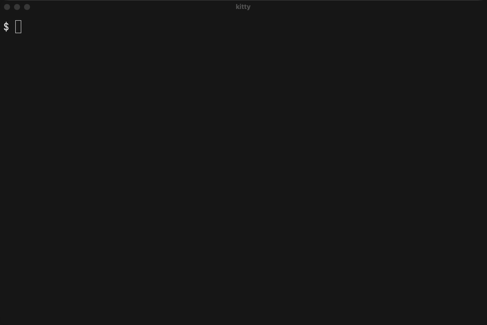
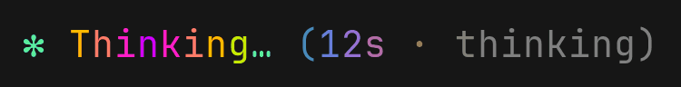
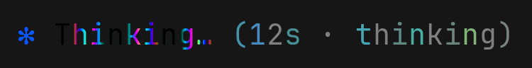

# rainbow-spinner

A Claude Code mod that draws the spinner line, the working indicator under the chat, in colour styles switched with `/spinner`.




## Install

In a Claude Code session:

```
/plugin install rainbow-spinner --marketplace Wizard1209/rainbow-spinner
```

Claude Code asks to confirm the marketplace and the install scope; `/spinner` is there at once, without a restart. `claude plugin install` takes the same arguments in a shell.

```sh
# update, then restart Claude Code
claude plugin marketplace update rainbow-spinner && claude plugin update rainbow-spinner

# remove; add --scope to uninstall for a project install
claude plugin uninstall rainbow-spinner && claude plugin marketplace remove rainbow-spinner
```

The mod uses Claude Code's function hooks, an early-access plugin API that may change between releases. It is tested with Claude Code 2.1.322.

## Use

```
/spinner <style>
```

| Style | The spinner line |
|---|---|
| `off` | Claude Code's own. The default: the mod changes nothing. |
| `temper` | Coloured text. |
| `holo` | The spinner's word drawn as a picture. |
| `bloom` | Pastel text after a growing plant icon. |

`/spinner` alone names the style that is on and lists the styles. The choice is kept across sessions, and a `/spinner` given while Claude works runs when the turn ends.

Where the terminal cannot draw a style, the line is drawn as `temper` and the reply says why:

```
rainbow-spinner: spinner: holo → temper · Claude Code draws no pictures in this terminal
```

Where Claude can fix that, the reply is a box with the reason and what to ask Claude for:

```
╭──────────────────────────────────────────────────────────────────────────╮
│ The holo style is drawn as temper: iTerm2 shows pictures only in Claude  │
│ Code's fullscreen mode.                                                  │
│ Ask Claude to turn on fullscreen mode.                                   │
╰──────────────────────────────────────────────────────────────────────────╯
```

## Styles

The colours are made for a dark background.

### temper



Rims of colour spread from the middle of the word. Under a rim a letter passes through the colours of tempered steel and sinks back into black.

### holo



The same colours in bands about two letters wide, so the colour moves inside each letter. The picture's letters are JetBrains Mono, whatever the terminal's font; a word in another script, such as Cyrillic, is drawn as `temper`.

### bloom


A pastel rainbow flows along the line while a plant grows before the word, from seed to flower.

## Terminals

`temper` is text and draws in any terminal. `holo` needs a terminal Claude Code sends pictures to, or WezTerm running the mod's [WezTerm module](wezterm/README.md). `bloom` draws its plant with the terminal's font where that has [Nerd Font](https://www.nerdfonts.com) icons, otherwise as a picture.

| Terminal | `holo` | `bloom` plant | Tested |
|---|---|---|---|
| kitty 0.48 (macOS, Linux under WSLg) | picture | font icon | yes |
| iTerm2 3.7 (macOS), fullscreen mode | picture | font icon if the profile font is a Nerd Font, else picture | yes |
| iTerm2 3.7 (macOS), main screen | `temper` | font icon if the profile font is a Nerd Font, else `temper` | yes |
| WezTerm 20240203 and nightly (macOS), nightly (Windows, WSL pane) | picture with the WezTerm module, else `temper` | font icon | yes |
| Ghostty | picture | font icon | no |
| Windows Terminal, Terminal.app | `temper` | `temper` | no |
| Any other terminal | `temper`, or a picture if Claude Code sends one | the same | no |

Rows marked yes were tested; the rest is what Claude Code's documentation and the mod's code say. Fullscreen mode is Claude Code's fullscreen renderer (`/tui fullscreen`); the main screen is its classic one. Inside tmux the mod tries pictures, and Claude Code sends them only with tmux's `allow-passthrough` and `focus-events` on.

## Cost

CPU of the Claude Code process while Claude works, in per cent of one core (Apple M-series):

| Spinner line | kitty | iTerm2, fullscreen mode |
|---|---|---|
| Claude Code's own | 5–6 | 2.7 |
| `temper` | 11–12 | 6.5 |
| `holo` | 20–22 | 10.3 |

`bloom` costs about as much as `temper`. The cost is there only while Claude works, and it is the same in a hidden tab. The WezTerm module has a cost of its own: see [its README](wezterm/README.md#cost).

## How it works

A style is a colour field: a function from a place on the line and a time to a colour. The mod takes over Claude Code's spinner component and samples the field at each letter for text, or at each pixel column of the word for a picture, which goes to the terminal as PNG frames swapped in place.

The [architecture page](https://wizard1209.github.io/rainbow-spinner/) shows it in diagrams.

## Development

```sh
claude --plugin-dir .                           # a session with the mod from this folder
claude plugin test .                            # tests
npx -y -p typescript@5.9.3 tsc -p . --noEmit    # type-check
claude plugin validate .                        # manifests and hooks
lua tests/wezterm.test.lua                      # the WezTerm module, with Lua 5.4
```

The type-check reads Claude Code's API types from `.claude-plugin/types/`, which Claude Code writes when a session loads the mod from this folder. `types/state.d.ts`, which `.claude-plugin/plugin.json` names, declares the type of the mod's session state. A style is one file in `hooks/styles/` that exports a `Style` (`hooks/core/style.ts`), plus one entry in `STYLES` in `hooks/styles/index.ts` and its name in the tests that list the styles, `tests/command.test.tsx` and `tests/caps.test.ts`.

[bench/](bench/README.md) holds the live harness: it records what kitty and iTerm2 show of the line, frame by frame, and what that costs.

## Licence

[MIT](LICENSE) © 2026 Wizard1209. The plant icons are from Material Design Icons (Apache-2.0) and the letters of `holo` from JetBrains Mono (OFL-1.1): see [THIRD_PARTY.md](THIRD_PARTY.md).
